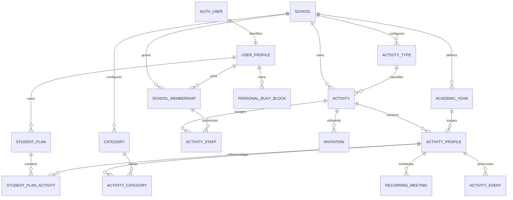

# Club Compass v3 architecture

Source: Club_Compass_Codex_Master_Build_Prompt_v3.docx, sections 1–20 and appendices, supplied November 11, 2026. This replaces the September phase plan. The current delivery stops at Milestones 0 and 1.

## Product and scope

Club Compass is a school-agnostic, browser-first activity discovery and planning service. NNHS is the first pilot; school identity, timezone, academic years, types, and categories are database configuration. The supplied research (662 survey responses, 300 comments, 77% wishing they had learned of an activity earlier, 54% very likely to use the site, and 14% participating in zero activities) motivates discovery, current joining information, mobile usability, and practical scheduling. These are supplied research claims, not independently validated analytics.

A modular Next.js App Router monolith uses React, TypeScript, Tailwind, Zod, Supabase Auth, and PostgreSQL. Server Components render data; interactive forms use Client Components. Session cookies are refreshed by the Supabase SSR client in proxy.ts. Runtime queries always use the public key plus the user's identity. Privileged bootstrap scripts run locally, never in a browser bundle.

Milestone 1 includes minimal Activity, ActivityProfile, AcademicYear, ActivityType and ActivityStaff records to prove assignment permissions. These are security fixtures and read-only portal foundations, not a completed activity authoring feature. Milestone 2 extends these tables with the questionnaire rather than replacing them.

## Complete relationship model



See [entity-model.md](entity-model.md) for required/optional fields, keys, ownership and rollout. Activities have one structural type and multiple discovery categories in v3; see decision 002. A profile's publication state and facts are versioned by academic year, while the Activity UUID and slug remain stable.

## Role and permission matrix

An ACTIVE membership grants one role per school. A person can belong to multiple schools with different roles. No role supplied by a browser, email domain, URL, or auth user_metadata grants privileges.

| Operation | Visitor | STUDENT | STAFF | ADMIN |
| --- | --- | --- | --- | --- |
| Read school portal and current published profiles | No | Own schools | Own schools | Own schools |
| Read draft / historical profiles | No | No | Assigned activities | All own-school activities |
| Edit activity name or profile description (M1 DB boundary) | No | No | Assigned only | Own school |
| Create/submit profiles (M2) | No | No | School policy / assigned | Own school |
| Publish/unpublish (M2/M7) | No | No | Only via future explicit school policy | Own school |
| Change membership roles or assignments | No | No | No | Controlled future admin workflow |
| Read/write private plans and busy blocks (M5/M6) | No | Own records | No | No normal admin access |
| Cross-school private read/write | No | No | No | No |
| Read own minimal user profile | No | Yes | Yes | Yes |

M1 deliberately grants no application INSERT/UPDATE/DELETE on memberships or assignments, and no profile status update. Bootstrap is the only membership provisioning path until controlled onboarding exists. ADMIN is school-scoped; a future PLATFORM_ADMIN must use a separate audited access model.

## Authorization and RLS

Each protected route checks a verified auth user and ACTIVE membership for the URL school. Nested staff/admin layouts check allowed roles; each page/data query also checks so a layout is never the sole boundary. Server Actions re-check before any mutation. Missing login redirects to /login; authenticated but wrong-school access returns a non-disclosing 404; wrong-role access redirects to that school's authorized landing page.

RLS is enabled on every exposed table. Explicit table/column grants are separate from row predicates. Composite foreign keys include school_id on every child relationship. Helper functions in a non-exposed private schema have fixed empty search_path and narrowly scoped boolean outputs. SECURITY DEFINER helpers avoid recursive membership policies; they derive identity from auth.uid(). They never accept an arbitrary caller user ID.

Student visibility requires active school + active membership + active activity + PUBLISHED profile in the current academic year. STAFF can additionally see and update assigned activities. ADMIN can read its school's activities and profiles; it cannot administer another school. Students cannot modify activity data; staff cannot publish, reassign, change school ownership or self-promote. Immutable school ownership and column grants prevent moving records across tenants.

## Lifecycle and rollover

Profile status: SETUP → STAFF_ASSIGNED → INVITED → DRAFT → SUBMITTED → APPROVED → PUBLISHED; SUBMITTED → NEEDS_REVISION → DRAFT/SUBMITTED; PUBLISHED → INACTIVE. ADMIN approves/publishes or returns for revision. STAFF may edit assigned descriptive facts; publishing is an explicit server/database workflow, not a free-form status field.

Each Activity has one ActivityProfile per AcademicYear. Rollover creates a new year's DRAFT profile with selected copied descriptive fields. It does not update or delete the previous year's profile. Schedules and events reference the profile's year; dates must fit the intended season/year. Activation of a new current year is atomic, with at most one current year per school. Copied schedules, deadlines, costs and contacts need verification; last_verified_at is cleared. Historical student plan items retain their original year and are not silently transferred.

M1 implements academic-year identity and profile separation; copy-forward, status transitions and verification UI are deferred.

## Routes and layouts

| Route | Access / implementation |
| --- | --- |
| / | Public neutral welcome and sign-in entry |
| /login, /auth/callback | Public authentication endpoints |
| /schools | Signed-in school chooser; redirects single-membership users |
| /s/[schoolSlug] | Protected school entry; redirects by role |
| /s/[schoolSlug]/explore | Any active member; current published fixtures only in M1 |
| /s/[schoolSlug]/activities/[activitySlug] | Current published profile; M1 foundation |
| /s/[schoolSlug]/account | Own membership and account |
| /s/[schoolSlug]/staff | STAFF or ADMIN; assigned activity summary |
| /s/[schoolSlug]/admin | ADMIN only; own-school counts |
| /s/[schoolSlug]/staff/activities/... | M2 authoring/edit/preview; M3 schedule/events |
| /s/[schoolSlug]/my-plan, /compare | M5 |
| /s/[schoolSlug]/calendar | M6 |
| /s/[schoolSlug]/admin/{activities,staff,invitations,categories,settings} | M7 operational tools |

Root layout supplies accessible framing. School layout supplies identity and role-aware navigation. Staff/admin layouts reinforce role boundaries. Login success goes to the user's role landing page, or school chooser for multiple memberships. Sign out clears the browser session and refreshes all layouts. Visiting Explore never changes the signed-in identity.

## Source boundaries

```text
src/app/                         routes, layouts, route handlers
src/components/layout/          shared presentation
src/features/auth/              login/sign-out forms and actions
src/features/activities/        authorized read queries, later authoring
src/lib/auth/                   verified session, membership and route guards
src/lib/permissions/            pure role and assignment rules
src/lib/validation/             runtime schemas
src/lib/supabase/               browser/server clients and environment parsing
src/types/                      domain and generated database types
src/test/                       unit tests
tests/e2e/                      repeatable browser regression checks
supabase/migrations/            ordered forward-only v3 schema
supabase/tests/                 transactional pgTAP allow/deny tests
scripts/                       local bootstrap, config, validation
docs/decisions/                 explicit assumptions and tradeoffs
```

## Questionnaire architecture (M2)

Nine steps: identity/classification; purpose; eligibility/joining; commitment; recurring schedule; events/deadlines; leadership/contact; practical costs/equipment/transport; review. Use a mature form library (React Hook Form planned), Zod schemas per step, and a server save service that verifies assignment and school on every write. Nullable drafts permit partial progress; a separate publication schema validates required descriptions, joining instructions, contact, and commitment. Structured choices use enums, numeric ranges, IDs and arrays; narrative notes supplement rather than replace structured data.

Server autosave is debounced and versioned with updated_at/optimistic concurrency to detect lost updates. Display saving/saved/offline/error states. Preserve local recovery drafts keyed by user/school/profile; clear only after confirmed persistence. Local recovery is not the source of truth. Staff can return after publication; draft revisions and publication policy must be explicit. No questionnaire/UI saves are implemented in M1.

## Scheduling and conflict strategy (M3/M6)

School timezone is an IANA identifier supplied by school configuration, not a framework default. Recurring times are local date/time values plus weekday numbers (ISO Monday=1…Sunday=7), recurrence and effective date range. Events store start/end timestamptz in UTC. Busy blocks use the student's school timezone and optional dates; no timezone inference from the computer.

Project recurrences into actual dated intervals for the requested visible range before comparing. Convert using a timezone-aware library with explicit DST policy: skip nonexistent local occurrences with a visible warning; select the earlier offset for ambiguous times and label it. Reject zero/negative durations; split overnight recurring blocks into adjacent day rows initially. Permit multi-day dated events. Date endpoints for recurrence are inclusive; intervals are half-open [start,end). Conflicts satisfy startA < endB AND startB < endA. Touching boundaries do not overlap. Return both IDs, date, intersection start/end and precision; tentative/varied schedules generate possible-conflict warnings. Never block saving an activity or automatically remove it.

Required fixtures: M/W/F work 17:00–19:00 against Monday 16:30–17:30 yields 17:00–17:30; touching Tuesday times do not conflict; different weekdays do not conflict; Friday 18:00–20:00 event against work yields 18:00–19:00. Compare event/event, event/recurrence and recurrence/recurrence with date ranges and DST. Unknown/varies is not interpreted as free time.

## Privacy threat review

| Threat | Boundary / mitigation |
| --- | --- |
| School ID tampering | Verify membership at DAL and action; composite keys; RLS checks active membership and school |
| Role spoofing / self-promotion | Membership roles in protected rows, no browser writes, never trust user_metadata |
| Unassigned staff writes | RLS checks ActivityStaff and active STAFF membership, including direct API calls |
| Private student schedules leaked to staff/admin | Future plans/busy blocks have owner-only policies, no admin override or global support UI |
| Sensitive busy labels (religion, employment, health) | Labels/notes optional; generic Busy default; no logs, telemetry or client analytics of content |
| Service credentials in browser | Public key only in runtime; privileged local scripts kept outside src; secret check |
| Session theft / stale role | SSR cookie refresh, verified getUser, per-request membership checks, safe internal redirects, no shared user data cache |
| Old-year/private drafts exposed | Published-current-year visibility, no fallback fixture bypass when backend fails |
| Invitation theft | Future random single-use expiring tokens stored hashed; bind acceptance to authenticated email and activity |
| Auth/database failures mistaken for empty data | Error boundaries and actionable setup instructions; fail closed |
| Excess data collection | No GPA, grades, student IDs, demographics, college preferences, advertising or behavioral profiling |

Plans, busy blocks and invitations are design-only until their milestones; do not claim implemented privacy tests for absent tables.

## Migration, seeding and testing

Fresh v3 project uses separate project ID/ports and new migration history. Old code remains recoverable at git commit 055557b and its database volumes remain untouched. Do not run v3 migrations against the old project. Production upgrades require explicit reviewed export/transform/import, not a reset.

Migrations are transactional, immutable after application, and applied in order. Seed contains only clearly fictional activities for the NNHS demo and a second fictional school; no real survey respondents or staff are imported. Local bootstrap creates three roles per school and assigns staff using a privileged client only after enforcing loopback/project identity. Accounts are email-confirmed locally. Hosted accounts require trusted administrative provisioning; local fixed passwords are never seeded remotely.

Unit tests exercise role decisions, tenant matching, safe return URLs and input/configuration validation. SQL tests impersonate anon, students, assigned/unassigned staff, admins, suspended members and other schools. Assert allowed and denied operations, immutable ownership, forbidden publication and self-promotion, and draft/history visibility. Browser tests use the real login forms, inspect cookies through behavior, test refresh/signout, role/wrong-school routes, and phone/Chromebook widths. Typecheck, ESLint, production build and secret checks gate each milestone. M0 has no database tables and records SQL gate as not applicable, not passed.

See [implementation-plan.md](implementation-plan.md), [design-system.md](design-system.md), [decisions/001-v3-restart.md](decisions/001-v3-restart.md) and the milestone reports for evidence.
